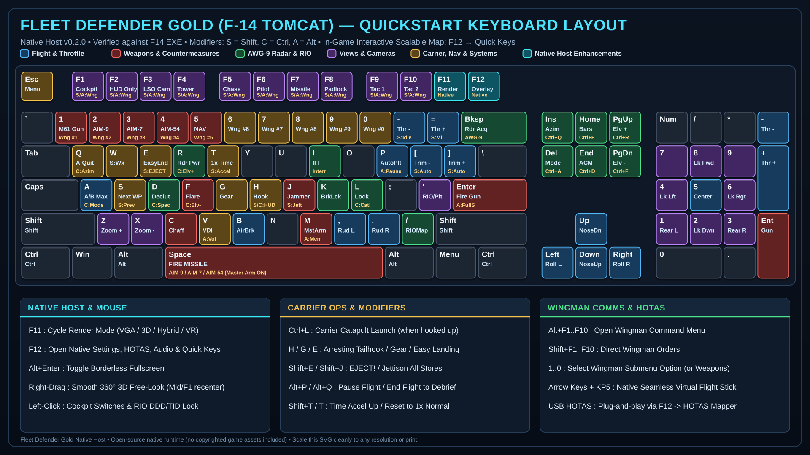

# Fleet Defender Gold (F-14 Tomcat) — Native Host

A standalone C++20 native host (SDL3 + OpenGL + Dear ImGui + Munt `libmt32emu` + `libx86emu`) that runs the original 1994 **MicroProse Fleet Defender Gold** MS-DOS binaries (`F14.COM` → `F.EXE` → `F14.EXE` / `F14S.EXE` / `F14JUKE.EXE`) directly on modern Windows outside of DOSBox — upgrading rendering, 360° cockpit & padlock, audio, F-14 flight physics, and multi-HOTAS input while preserving Fleet Defender's authentic AWG-9 radar, Pilot/RIO cockpits, HUD, VDI, HSD, carrier operations, and dynamic campaigns 100% intact.

> **Legal Notice:** This repository and its release binaries contain **only original host source code and open-source libraries**. No copyrighted MicroProse game binaries, data files, manuals, or Roland CM-32L / MT-32 ROMs are included. You must supply your own legally owned **Fleet Defender Gold** installation (e.g., GOG.com, Steam, or original CD-ROM) and your own Roland CM-32L / MT-32 ROMs.

---

## Quickstart Keyboard Layout

*(Resolution-independent vector diagram — click to zoom infinitely, or open interactively inside the Launcher and `F12 → Quick Keys` where it dynamically scales to any monitor resolution.)*



---

## Highlights

- **1-Click Native Windows Installer & Full Tabbed GUI Launcher:**
  - Single-file self-extracting setup (`FleetDefenderGold-Native-Setup-v0.2.0.exe`) with automatic GOG / Steam / Retail detection, optional Roland ROM folder detection, Desktop shortcut, safe backup (`_f14_native_backup\`), and clean uninstall (`/S` and `/U` silent CLI modes also supported).
  - Built-in **Tabbed Startup GUI Launcher** with 100% parity with `F12` in-game settings: **Play & Paths** (`F14.COM`, `F14S.EXE`, `F14.EXE`, `F14JUKE.EXE` + local PDF manuals), **Audio & Mixing** (Roland MT-32/CM-32L & SB16 voice mixers, radio ducking, warm cockpit enhance, polyphony, live test tones), **3D & Display** (render modes, borderless fullscreen, resolution presets, FOV, smart scaling), **HOTAS & Input** (live USB axis deadzones/curves, buttons, POV hats, pinky shift), **Sim Realism & DOS** (`CONFIG.F14` & `JOY.F14` editor + 240 Hz F-14 FM), and **Quick Keys** (dynamic resolution-scaling vector keyboard).
- **Seamless Full-Suite DOS Process Chaining (`F14.COM` → `F.EXE` → `F14.EXE` / `F14S.EXE`):**
  - Full real-mode MS-DOS `INT 21h` process EXEC stack (`AX=4B00h`/`4B03h`/`4Ch`/`4Dh`/`52h`) and 16 MB EMS 4.0 (`INT 67h` incl. `AX=5000h`, `AH=51h`, `AH=53h`, `AH=57h`) so all textures, digital speech (`GAME.DGT`), and moving RIO heads load cleanly.
- **4 Live Render Modes (`F11` cycles Classic VGA → Modern 3D → Hybrid Cockpit → VR Stereo Preview):**
  - **Hybrid Cockpit:** Crisp 4:3 original F-14 Pilot/RIO cockpit & live HUD/VDI/HSD/RWR composited over the 60+ FPS HD OpenGL 3D world with **`Fill Widescreen 3D World`** enabled by default.
  - **Modern 3D:** Full 16:9 3D Virtual F-14 Tomcat Cockpit with harvested 360° Pilot/RIO interior views, variable-sweep wings (`20°–68°`), twin canted tails, and **Right-Mouse Drag 360° Free-Look**.
  - **Ocean, Volumetric Clouds & `.WLD` Theaters:** Enhanced DOS-palette maritime ocean with sun sheen, 3-layer live-weather volumetric 3D clouds, all 5 `.WLD` theaters (`NCN01`, `MEDN01`, `USAN01`, `KOR04`, `INDIA09`), all 236 `.3DZ` models + `.PCX` textures, and Why485 / Serfoss 2003 Smart Scaling.
  - **Unclamped 3D Padlock (`F8`) + Red X-Ray Target Box:** Smoothly tracks locked bandits and missiles through `±86°` pitch.
- **Audio Engine (`F12 → Audio`):**
  - Embedded Munt `libmt32emu` (Roland CM-32L / MT-32 via MPU-401 `0x330`), Sound Blaster 16 8-bit DMA Channels 1 & 3 + Direct DAC (`0x220`, IRQ 7) for `DIGITAL.F14` + `GAME.DGT`/`WRAP.DGT` digitized wingman/RIO/LSO speech, and OPL FM fallback.
- **Multi-HOTAS Mapper & Seamless Virtual Stick (`F12 → HOTAS`):**
  - Unlimited simultaneous USB sticks, throttles, rudders, and button boxes with deadzone/invert/curve tuning, button & POV-hat binder, pinky shift layer, `f14_hotas.json` profiles, and seamless Arrow-key + `KP5` virtual flight stick fallback.
- **Optional 240 Hz Native F-14A/B Tomcat Flight Model (`F12 → Flight Model`):**
  - Live-switchable between twin **TF30-P-414A** (F-14A) and **GE F110-GE-400** (F-14B/D) engines with authentic CADC automatic/manual variable wing sweep (`20°–68°`).
- **Fast-Boot Skip Intro (`--test-fastboot`):**
  - Skips `PLAYFLC.EXE` (`OPEN.FLC`) cleanly and boots straight to the Fleet Defender Main Menu in **~0.17 seconds**.

---

## Quick Start (End Users)

1. Install **Fleet Defender Gold** (GOG.com, Steam, or original CD-ROM).
2. Download **`FleetDefenderGold-Native-Setup-v0.2.0.exe`** from [Releases](https://github.com/ajalberd/fleet-defender-native/releases) and run it:
   - Auto-detects your Fleet Defender Gold install and optional Roland CM-32L / MT-32 ROM folder.
   - Creates a **Fleet Defender Gold [Native]** Desktop shortcut and launches immediately with zero console flash.
3. *(Optional)* Prefer portable? Extract **`FleetDefenderGold-Native-v0.2.0-portable.zip`** into your Fleet Defender Gold folder and run `f14_native.exe`.

### CLI Flags
| Flag | Description |
|---|---|
| `--launcher` | Force the Startup GUI Launcher on boot |
| `--no-launcher` / `--play` | Skip Startup Launcher and boot directly into the game |
| `--game-dir <path>` | Path to your Fleet Defender Gold install folder |
| `--rom-dir <path>` | Path to your Roland CM-32L / MT-32 `.ROM` folder |
| `--exe <name>` | Launch `F14.COM` (default), `F.EXE`, `F14.EXE`, `F14S.EXE`, or `F14JUKE.EXE` |
| `--test-fastboot` | Headless fast-boot smoke test (~0.17 s to Main Menu) |
| `--headless <insns>` | Deterministic headless execution with optional `--dump-vga`, `--dump-ram`, `--key`, `--click` |
| `--trace-audio` | Log MIDI / SysEx / audio diagnostics |

---

## Building & Packaging from Source (Windows / PowerShell)

Prerequisites: CMake 3.20+, Ninja, MinGW-w64 GCC 13+ (`gcc`, `g++`, `windres`), Python 3.10+ (with `Pillow` for regenerating PNG keymap), internet access on first configure.

```powershell
# Build f14_native.exe:
.\build.ps1

# Build + package 1-shot GUI Setup EXE, Portable ZIP, and SHA256SUMS.txt into dist/:
.\package_release.ps1 -Version 0.1.0
```

---

## Documentation & Licenses

- [recomp/HANDOFF.md](recomp/HANDOFF.md) — Technical architecture, verified `F14.EXE` DGROUP RAM map, `.WLD`/`.3DZ`/`.PCX`/`JOY.F14` binary specs, and solved low-level pitfalls.
- [THIRD_PARTY_LICENSES.txt](THIRD_PARTY_LICENSES.txt) — Open-source third-party library attributions (SDL3, Dear ImGui, libx86emu, Munt `libmt32emu`, `nlohmann/json`).
- Host source code is released under the [MIT License](LICENSE).
